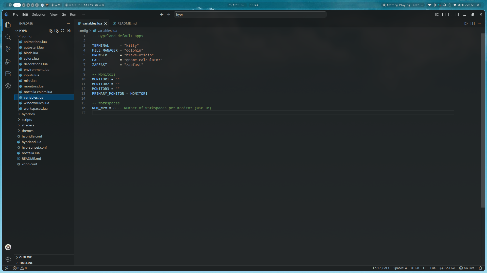
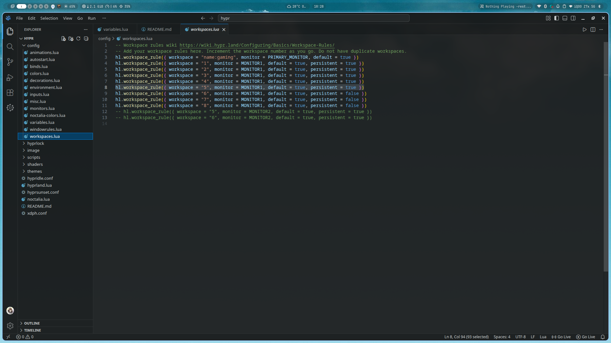

# noctalia-backup

kalo mau pake silahkan mas

Bayar pakai SayBread aja

Anyway jangan lupa copy atau rename jadi config.jsonc
-- jaga jaga aja sih heheh

# ADDING WORKSPACES
-- go to config/variables.lua >> search WPM_NUM, >> customize amount of WPM_NUM (MAX 10)

-- go config/workspaces.lua, >> copy this "hl.workspace_rule({ workspace = "5", monitor = MONITOR1, default = true, persistent = true })" (MAX 10), >> change the 'workspace = "5"' with the next number after 5.
